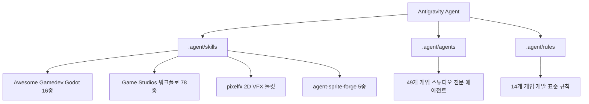

# Antigravity Game Development Environment (Godot Projects)

본 프로젝트(`Godot-Projects`)는 Antigravity 전용 게임 개발 스튜디오 환경으로 구성되어 있습니다.
모든 스킬과 에이전트, 규칙은 Antigravity 전용 디렉터리인 `.agent/`에 배치되어 있어 타 AI 코딩 에이전트(Claude Code 등)의 간섭 없이 Antigravity 단독으로 구동됩니다.

---

## 1. 탑재된 오픈소스 스킬 및 도구 체계

### 1) Awesome Gamedev Agent Skills (Godot 전용 스킬 16종)
경로: `.agent/skills/godot-*/`
- **핵심 언어/노드:** `godot-gdscript`, `godot-csharp`, `godot-nodes-scenes`, `godot-resources`, `godot-signals-groups`
- **게임플레이/물리:** `godot-2d-movement`, `godot-physics`, `godot-tilemap`, `godot-ui-control`, `godot-animation`
- **그래픽/오디오:** `godot-shaders`, `godot-audio`, `godot-3d-essentials`
- **네트워크/인프라:** `godot-multiplayer`, `godot-export`, `godot-gdscript-headless-testing`

### 2) Game Studios 프레임워크 (워크플로 스킬 78종 및 에이전트 49종)
경로: `.agent/skills/`, `.agent/agents/`, `.agent/rules/`
- 게임 기획/설계, 프로토타이핑, 스프린트 관리, 아트 바이블, QA, 코드 리뷰 등 게임 스튜디오의 전체 파이프라인 제공.
- 필요 시 `invoke_subagent` 또는 스튜디오 역할을 참고하여 `godot-specialist`, `creative-director`, `game-designer` 등의 역할 수행.

### 3) pixelfx (코드 기반 픽셀 VFX 엔진 및 스프라이트 시트 익스포터)
경로: `.agent/skills/pixelfx/`
- 244개의 실행 가능한 코드 기반 픽셀 아트 효과 라이브러리(`src/fx/`) 및 렌더러 내장.
- 실행 도구: `.agent/skills/pixelfx/tools/render.mjs`, `list.mjs`, `act.mjs`
- Godot 익스포트: `node .agent/skills/pixelfx/tools/render.mjs <effect> --sheet` 실행 시 Aseprite 호환 JSON 및 투명 PNG 스프라이트 시트 생성.

### 4) agent-sprite-forge (2D 스프라이트, 애니메이션, 맵 생성 툴킷 5종)
경로: `.agent/skills/{codeart2d, generate2dmap, generate2dmedia, generate2dsprite, video2dsprite}/`
- AI 프롬프트 기반 마스터 스틸 생성, 배경 제거(chroma keying/alpha), 프레임 슬라이싱, Godot SpriteFrames 및 Sprite3D 익스포트.
- `pixelfx`와 자동 연동 지원 (`PIXELFX_DIR=.agent/skills/pixelfx`).

---

## 2. 사용 및 개발 가이드

- Godot 4.x 기반 프로젝트 작업 시 정적 타입이 적용된 GDScript를 우선하며, 시그널 기반의 느슨한 결합(Decoupling)을 유지합니다.
- 새로운 VFX 생성 필요 시 pixelfx 라이브러리를 검색(`node .agent/skills/pixelfx/tools/list.mjs <keyword>`)하여 기존 효과를 커스텀하거나 새 코드를 작성합니다.
- 캐릭터 스프라이트 및 애니메이션 필요 시 `generate2dsprite` 및 `video2dsprite` 스킬의 지침을 따릅니다.
